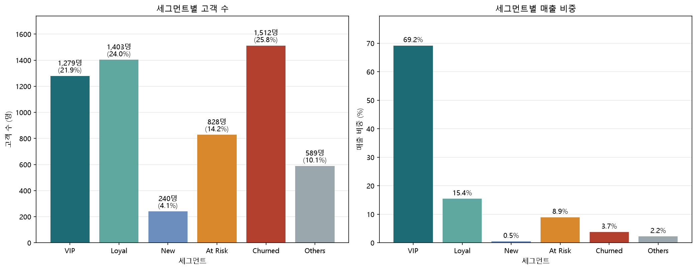
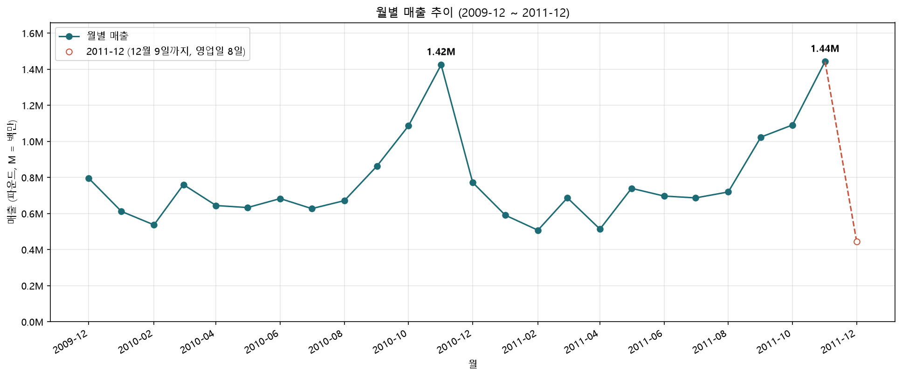

# 쇼핑몰 단골 찾기: RFM 고객 분석

영국 온라인 쇼핑몰의 2년치 거래 기록(약 107만 건)을 정리하고, **"누가 최근에, 자주, 많이 사는가"**(RFM)로 고객 5,851명을 6개 그룹으로 나눠 그룹별 마케팅 전략을 제안하는 분석 프로젝트입니다. 분석 기능은 `DataAnalyzer` 클래스(`src/pipeline.py`)로 만들고, 분석 과정과 해석은 노트북(`notebooks/analysis_report.ipynb`)에 단계마다 적었습니다.

> **핵심 결과**
> - 고객의 **21.9%(VIP)가 매출의 69.2%**를 만듭니다. 상위 20% 고객이 매출의 76.7%입니다.
> - 예전에 평균 5.0회·£1,803을 쓰다가 **평균 369일째 오지 않는 고객(At Risk) 828명**이 먼저 되찾을 대상입니다.
> - 한 번만 산 고객 1,621명 중 **70.1%가 이미 이탈(Churned)** 상태라, 첫 구매 후 재구매 유도가 가장 큰 숙제입니다.

## 목차

1. [데이터와 출처·라이선스](#1-데이터와-출처라이선스)
2. [폴더 구조](#2-폴더-구조)
3. [실행 방법](#3-실행-방법)
4. [분석 흐름](#4-분석-흐름)
5. [DataAnalyzer 사용법](#5-dataanalyzer-사용법)
6. [주요 결과](#6-주요-결과)
7. [인사이트 (근거 · 실행 · 검증)](#7-인사이트-근거--실행--검증)
8. [한계와 주의](#8-한계와-주의)
9. [과제 요구사항 대응표](#9-과제-요구사항-대응표)

---

## 1. 데이터와 출처·라이선스

이 과제는 **고객의 구매 기록**(RFM)과 **상품 이미지**(이미지 수치화)가 모두 필요한데, 둘을 한 번에 가진 공개 데이터를 찾기 어려워서 **데이터 두 개를 역할을 나눠 사용**합니다.

| | ① 거래 데이터 | ② 상품 데이터 |
|---|---|---|
| 이름 | **Online Retail II** | **Fashion Product Images (Small)** |
| 쓰임 | 정제·결측치·이상치·통계·**RFM** | 상품명 텍스트 피처, **이미지 평균·표준편차**, 그룹별 결측치 대치 |
| 출처 | UCI Machine Learning Repository, Daqing Chen 기증(2019-09-20) · [페이지](https://archive.ics.uci.edu/dataset/502/online+retail+ii) · DOI [10.24432/C5CG6D](https://doi.org/10.24432/C5CG6D) | Kaggle, Param Aggarwal · [페이지](https://www.kaggle.com/datasets/paramaggarwal/fashion-product-images-small) |
| 라이선스 | **CC BY 4.0** (출처를 밝히면 사용·수정 가능) | **MIT** (Kaggle 데이터셋 페이지에 표기된 값, 2026-11-20 확인) |
| 크기 | 1,067,371행 × 8컬럼 (2009-12-01 ~ 2011-12-09) | 사진 44,441장 + 정보 표 `styles.csv` 44,424행 |
| 받은 날짜 | 2026-11-20 | 2026-11-20 |

> **꼭 알아둘 한계:** 두 데이터는 **서로 연결되지 않습니다**(같은 상품이 아님). 그래서 "고객 구매 분석"과 "이미지 수치화"는 별도로 진행했고, 이미지와 구매 행동의 관계는 분석하지 않았습니다. 라이선스는 다운로드 전에 각 페이지에서 한 번 더 확인하세요.

**인용:** Chen, D. (2019). *Online Retail II* [Dataset]. UCI Machine Learning Repository. https://doi.org/10.24432/C5CG6D

**가공 기록**
- **Online Retail II:** 원본은 엑셀 1개(시트 2개: `Year 2009-2010` 525,461행, `Year 2010-2011` 541,910행)입니다. 두 시트를 **원본 그대로 이어 붙여** CSV 1개(1,067,371행)로 저장했습니다. 두 시트가 2010-12-01~09를 겹쳐 갖고 있어서 중복이 생기며, 이는 분석 코드의 정제 단계에서 제거하고 개수를 기록합니다.
- **Fashion:** zip 안의 `images/`와 `styles.csv`만 사용합니다(zip에 같은 내용이 `myntradataset/` 폴더로 한 벌 더 있어 위쪽 한 벌만 씀). `styles.csv`는 상품명에 쉼표가 있는데 따옴표로 감싸지 않은 **22줄(0.05%)** 이 있어 `on_bad_lines="skip"`으로 건너뛰고 읽습니다.
- **원본 데이터는 용량이 커서 Git에 올리지 않습니다**(`data/`는 `.gitignore` 대상). 아래 [실행 방법](#3-실행-방법)대로 직접 받아서 두면 됩니다.

---

## 2. 폴더 구조

```
shopping-rfm-analysis/
├── README.md
├── requirements.txt              # numpy, pandas, matplotlib, seaborn, jupyter (버전 고정)
├── .gitignore                    # data/ 와 .venv/ 제외
├── src/
│   ├── __init__.py
│   └── pipeline.py               # DataAnalyzer 클래스 (분석 기능 전부)
├── notebooks/
│   └── analysis_report.ipynb     # 분석 보고서 (1~6장, 단계마다 해석)
├── images/                       # 노트북이 저장한 차트 PNG 8장
└── data/                         # 직접 받아서 두는 곳 (Git에 없음)
    ├── online_retail_II.csv
    └── fashion_small/
        ├── styles.csv
        └── images/               # 상품 사진 {id}.jpg
```

---

## 3. 실행 방법

**필요한 것:** Python **3.12 이상** (3.14.3에서 검증), 인터넷(라이브러리·데이터 내려받기), 디스크 여유 약 2GB. (가상환경 약 0.4GB + 데이터 약 0.75GB + 내려받은 zip·엑셀·변환용 임시 환경 약 0.8GB. 마지막 것들은 데이터를 `data/`에 둔 뒤 지워도 됩니다.)

### 3-1. 저장소 받기와 가상환경 만들기

```bash
git clone https://github.com/byungwoo2026/shopping-rfm-analysis_A1-1.git
cd shopping-rfm-analysis_A1-1

python -m venv .venv
# Windows PowerShell:  .venv\Scripts\Activate.ps1
# macOS / Linux:       source .venv/bin/activate
pip install -r requirements.txt
```

분석에는 **NumPy, Pandas, Matplotlib, Seaborn**만 씁니다(`jupyter`는 노트북 실행용). 사진 읽기는 `matplotlib`의 `imread`를 쓰며, 이 함수가 내부적으로 쓰는 Pillow는 Matplotlib가 함께 설치하는 것으로 코드에서 직접 가져오지 않습니다.

### 3-2. 거래 데이터 받아서 CSV로 만들기 → `data/online_retail_II.csv`

1. [UCI 페이지](https://archive.ics.uci.edu/dataset/502/online+retail+ii)에서 zip을 내려받아 풀면 `online_retail_II.xlsx`(시트 2개)가 나옵니다.
2. 엑셀을 읽으려면 `openpyxl`이 필요한데 이는 분석용 허용 라이브러리 밖이므로, **분석용 `.venv`와 분리된 임시 환경에서 한 번만** 변환합니다.

   ```bash
   python -m venv convert_env                   # 임시 환경 (변환이 끝나면 지워도 됨)
   # 활성화한 뒤:
   pip install pandas openpyxl
   python convert_uci_to_csv.py online_retail_II.xlsx online_retail_II.csv
   ```

   `convert_uci_to_csv.py`의 내용 (세 줄이 핵심입니다):

   ```python
   import sys
   import pandas as pd

   sheets = pd.read_excel(sys.argv[1], sheet_name=None)      # 시트 2개를 {시트 이름: 표}로 읽기
   df = pd.concat(sheets.values(), ignore_index=True)         # 두 시트를 위아래로 이어 붙이기 (원본 그대로)
   df.to_csv(sys.argv[2], index=False, encoding="utf-8")      # CSV로 저장
   ```

   결과 CSV가 **1,067,371행 × 8컬럼**(`Invoice, StockCode, Description, Quantity, InvoiceDate, Price, Customer ID, Country`)이면 맞습니다(변환에 약 3분).
3. `online_retail_II.csv`를 저장소의 `data/` 폴더에 둡니다.

### 3-3. 상품 이미지 데이터 받기 → `data/fashion_small/`

1. [Kaggle 페이지](https://www.kaggle.com/datasets/paramaggarwal/fashion-product-images-small)에서 내려받습니다(Kaggle 로그인 필요, zip 약 593MB).
2. 압축을 풀어 **`images/` 폴더와 `styles.csv`** 를 `data/fashion_small/`에 둡니다. (zip 안에 같은 내용이 `myntradataset/` 폴더로 한 벌 더 있으면 위쪽 한 벌만 사용)
3. 확인: `data/fashion_small/images/`에 사진 44,441장, `styles.csv`가 있어야 합니다.

### 3-4. 노트북 실행

- **VS Code:** `notebooks/analysis_report.ipynb`를 열고 오른쪽 위 **Select Kernel → `.venv`** 를 고른 뒤 **Run All**.
- **터미널:** 저장소 루트에서
  ```bash
  jupyter nbconvert --to notebook --execute notebooks/analysis_report.ipynb --output executed.ipynb --output-dir results
  ```
- 소요 시간: **약 2분**(이 환경에서 2분 3초 측정). 사진 2,000장을 읽는 단계(4장)가 가장 오래 걸립니다. 실행 결과는 `results/executed.ipynb`로 저장됩니다(`results/`는 Git에서 제외).
- **새 환경에서 README 순서대로 따라 해서 검증했습니다.** 새 가상환경에 설치 → 데이터 배치 → 노트북을 끝까지 실행하면 오류·경고 없이 끝나고, 164칸의 출력이 저장소의 노트북과 같습니다(설치 약 5분, 엑셀 변환 약 3분).
- **실행이 맞게 됐는지 확인:** 노트북 6장 끝의 세그먼트 표에서 **고객 수 합계가 5,851명, 매출 비중 합계가 100.0%** 인지 보세요.

---

## 4. 분석 흐름

노트북은 장마다 **"설명 → 코드 → 결과 → 해석(수치 근거 + 시사점)"** 순서입니다.

| 장 | 내용 | 핵심 |
|---|---|---|
| 1장 | 데이터 개요 | `head`/`info`/`describe`로 구조 확인. 고객 번호 22.77% 결측, 음수 수량·0 단가, 평균 9.94 대 중앙값 3 같은 극단값 발견 |
| 2장 | 정제와 결측치 처리 | 중복·취소·0 이하 제거(1,067,371 → 1,007,913행), 그룹별 결측치 대치(`usage` 317행 등) |
| 3장 | 이상치 탐지와 처리 | IQR 직접 구현, 비판매 코드·취소된 원 주문 제거, 극단값은 자른 새 컬럼으로 처리, 처리 전후 박스플롯·히스토그램 |
| 4장 | 텍스트·이미지 피처 | 상품명 단어·글자 수, 사진 1,980장을 배열로 쌓아 평균·표준편차(**반복문 없이 배열 연산**) |
| 5장 | 통계 분석과 시각화 | 기초 통계표, 상관계수(Pearson·Spearman), 막대·라인·히트맵·산점도 |
| 6장 | RFM 고객 세분화 | R·F·M 계산·점수·세그먼트·마케팅 전략 |

**데이터 정제로 행이 줄어든 과정** (거래 데이터)

| 단계 | 제거한 행 | 남은 행 |
|---|---:|---:|
| 원본 | | 1,067,371 |
| 완전히 같은 행(중복) | 34,335 | 1,033,036 |
| 취소 주문(주문번호가 `C`로 시작) | 19,104 | 1,013,932 |
| 수량 0 이하 | 3,393 | 1,010,539 |
| 단가 0 이하 | 2,626 | 1,007,913 |
| 비판매 코드 14종(배송비·수기 입력·수수료·조정·테스트) | 4,479 | 1,003,434 |
| 취소와 짝이 맞는 원 주문(같은 고객·상품·수량, 24시간 이내) | 1,331 | **1,002,103** |

뒤의 두 단계는 이상치(금액 최대 £168,469.60)를 들여다보다가 발견했습니다. 가장 큰 두 주문은 12분·16분 뒤 전량 취소됐는데 취소 전표만 지워서 원 주문이 남아 있었습니다.

**이상치 처리 방침:** IQR(`threshold=1.5`) 기준 금액 이상치가 8.16%이고 **금액의 49.2%** 를 차지해, 오류로 보고 지우면 매출이 절반 사라집니다. 그래서 오류(비판매 코드·취소된 주문)만 제거하고, 진짜 대량 구매는 **지우지 않고 상한에서 자른 새 컬럼**(`amount_clipped` 등)을 통계·그래프에만 씁니다. **RFM은 원본 `amount`로 계산**합니다.

---

## 5. DataAnalyzer 사용법

표 하나를 담는 분석 도구입니다. 같은 클래스로 **거래표와 상품표에 인스턴스를 각각** 만들어 씁니다. 분석 중인 표는 `analyzer.df`에 들어 있습니다.

```python
from src.pipeline import DataAnalyzer, RETAIL_RENAME

retail = DataAnalyzer("data/online_retail_II.csv")
retail.load_data(date_cols=["InvoiceDate"], rename=RETAIL_RENAME,
                 dtype={"Invoice": "str", "StockCode": "str"})
retail.clean_transactions()                         # 중복·취소·0 이하 제거 + amount = quantity × price
retail.remove_non_product_rows()                    # 비판매 코드 제거
retail.remove_cancelled_orders(hours=24)            # 취소로 사라진 원 주문 제거
outliers = retail.detect_outliers("amount", threshold=1.5)
rfm = retail.calculate_rfm("customer_id", "order_date", "amount", invoice_col="invoice")
retail.segment_customers()
print(retail.segment_summary())
```

굵게 표시한 4개가 과제가 이름까지 정해 준 필수 메서드입니다.

| 메서드 | 하는 일 | 주요 인자 |
|---|---|---|
| **`load_data`** | CSV 읽기, 날짜 변환, 컬럼명 바꾸기 | `date_cols`, `rename`, (`read_csv` 옵션) |
| `clean_transactions` | 중복·취소·수량/단가 0 이하 제거, `amount` 생성, 단계별 제거 표 반환 | |
| `remove_non_product_rows` | 비판매 상품코드 행 제거 | `codes` |
| `remove_cancelled_orders` | 취소와 짝이 맞는 원 주문 제거 | `hours=24` |
| `missing_report` | 컬럼별 결측 수·비율 표 | |
| **`handle_missing_values`** | 그룹별 평균·중앙값·최빈값으로 결측치 대치 | `strategy`(`group_mean`/`group_median`/`group_mode`), `group_col`, `target_col` |
| `group_consistency` | 어떤 기준으로 묶어야 대치가 믿을 만한지 일치율 비교 | `target_col`, `group_cols` |
| **`detect_outliers`** | IQR 정상 범위를 벗어난 행 반환 (표는 바꾸지 않음) | `column`, `threshold=1.5` |
| `outlier_summary` | 여러 컬럼의 정상 범위·이상치 개수·비율 표 | `columns`, `threshold` |
| `treat_outliers` | 이상치를 자른(`clip`)/빈칸 처리(`remove`)한 **새 값** 반환 (원본 불변) | `column`, `method`, `threshold` |
| `add_text_features` | 단어 수·글자 수 컬럼 추가 | `text_col`, `prefix` |
| `load_images` | 사진을 읽어 같은 크기만 `(N, 80, 60, 3)` 배열로 쌓음 | `ids`, `image_dir`, `expected_shape` |
| `extract_image_features` | 사진별 평균·표준편차를 `axis` 배열 연산으로 계산 | `images`, `ids`, `step` |
| `summary_stats` | 개수·평균·중앙값·표준편차·Q1·Q3·최솟값·최댓값 표 | `columns` |
| **`calculate_rfm`** | 고객별 R·F·M 값과 1~5점 계산 | `customer_col`, `date_col`, `amount_col`, `invoice_col`, `ref_date` |
| `segment_customers` | 규칙을 위에서부터 보고 먼저 맞는 세그먼트 이름 부여 | `rules`, `default` |
| `segment_summary` | 세그먼트별 고객 수·평균 R·F·M·매출 비중 표 | |

모듈 함수 `iqr_bounds(values, threshold)`는 IQR 정상 범위를 구하는 핵심 계산입니다(Q1, Q3, IQR, 하한, 상한).

---

## 6. 주요 결과

### 6-1. RFM 정의

| 지표 | 뜻 | 계산 | 좋은 방향 |
|---|---|---|---|
| **R** Recency | 얼마나 최근에 샀나 | 기준일 − 마지막 구매일 (일수) | 작을수록 좋음 (점수는 거꾸로 부여) |
| **F** Frequency | 얼마나 자주 샀나 | **고유 주문번호의 개수** (행 수가 아님) | 클수록 좋음 |
| **M** Monetary | 얼마나 많이 썼나 | 구매 금액 합계 (**원본** `amount`) | 클수록 좋음 |

- **Recency 기준일 = 데이터의 마지막 거래일 + 1일 = 2011-12-10.** 마지막 거래는 2011-12-09 12:50입니다. +1일을 하는 이유는, 기준일을 마지막 날 당일로 잡으면 그날 구매한 고객의 R이 0일이 되므로 모든 고객이 1일 이상이 되게 하려는 것입니다.
- 각 지표를 고객 순위로 5등분해 1~5점(5점이 가장 좋음)을 줍니다. 같은 값이 많아 경계가 겹치는 오류를 피하려고 `rank(method="first")`로 순번을 매긴 뒤 `pd.qcut`을 씁니다.
- **RFM 대상은 5,851명**입니다. 고객 번호가 없는 행(전체의 22.6%, 금액의 13.4%)은 누구의 구매인지 몰라서 제외했습니다.

### 6-2. 세그먼트 규칙 (위에서부터, 먼저 맞는 것)

| 순서 | 세그먼트 | 조건 | 의미 |
|---|---|---|---|
| 1 | **VIP** | R ≥ 4, F ≥ 4, M ≥ 4 | 최근에, 자주, 많이 사는 핵심 고객 |
| 2 | **Loyal** | R ≥ 3, F ≥ 3 | 꾸준히 오는 고객 |
| 3 | **New** | R ≥ 4, **구매 횟수 = 1** | 최근에 처음 온 고객 |
| 4 | **At Risk** | R ≤ 2, F ≥ 3 | 예전엔 자주 왔는데 요즘 안 오는 고객 |
| 5 | **Churned** | R ≤ 2 | 오래 안 온 이탈 고객 |
| 6 | **Others** | 나머지 | 중간 고객 |

순서가 중요합니다. VIP 조건을 만족하는 고객은 Loyal 조건도 만족하므로, VIP를 먼저 보지 않으면 VIP가 한 명도 남지 않습니다. New를 F 점수가 아니라 **실제 구매 횟수**로 판정하는 이유는 [8장](#8-한계와-주의)에 적었습니다.

### 6-3. 세그먼트 요약 (노트북 6장-4의 `segment_summary()` 결과)

| 세그먼트 | 고객 수 | 고객 비율 | 평균 R(일) | 평균 F(회) | 평균 M(£) | 매출 비중 |
|---|---:|---:|---:|---:|---:|---:|
| **VIP** | 1,279 | 21.9% | 20.2 | 17.0 | 9,022 | **69.2%** |
| **Loyal** | 1,403 | 24.0% | 71.3 | 5.4 | 1,835 | 15.4% |
| **New** | 240 | 4.1% | 30.5 | 1.0 | 333 | 0.5% |
| **At Risk** | 828 | 14.2% | 368.6 | 5.0 | 1,803 | 8.9% |
| **Churned** | 1,512 | 25.8% | 456.7 | 1.2 | 413 | 3.7% |
| **Others** | 589 | 10.1% | 78.1 | 1.6 | 626 | 2.2% |
| **합계** | **5,851** | 100% | | | | **100.0%** |



세그먼트 인원이 4.1% ~ 25.8%로 한쪽에 몰리지 않아 규칙은 조정하지 않았습니다. VIP가 21.9%로 많은 것은 R·F·M이 함께 움직이기 때문입니다(F와 M의 순위 상관 0.86).

**그룹별 마케팅 전략**

| 세그먼트 | 전략 |
|---|---|
| **VIP** | 이탈 방지가 최우선. 전담 관리, 신상품·한정 상품 우선 안내, 감사 혜택 |
| **Loyal** | VIP로 키우기. 구매 간격을 줄이는 정기 프로모션, 금액 달성 쿠폰·번들 |
| **New** | 두 번째 구매 유도. 환영 메시지, 첫 구매 상품과 어울리는 추천, 기간 한정 재구매 쿠폰 |
| **At Risk** | 재활성화 우선. "오랜만이에요" 개인화 쿠폰, 과거 구매 상품의 신상품 알림 |
| **Churned** | 저비용 접근. 시즌 대량 메일 1회, 반응이 없으면 대상에서 제외 |
| **Others** | 구매 횟수 늘리기. 일반 프로모션으로 Loyal로 이끌기 |

### 6-4. 차트 (6종)

| 종류 | 파일 | 내용 |
|---|---|---|
| 히스토그램 | `images/histogram_before_after.png` | 금액·수량·단가 분포, 이상치 처리 전후 |
| 박스플롯 | `images/boxplot_before_after.png` | 가운데 50%와 이상치, 처리 전후 |
| 막대그래프 | `images/country_orders_bar.png` | 국가별 주문 수 |
| 라인차트 | `images/monthly_sales_line.png` | 월별 매출 추이 |
| 히트맵 | `images/correlation_heatmap.png` | 상관계수 |
| 산점도 | `images/scatter_plots.png` | 이미지 밝기–대비, 수량–단가 |

위 **6종 차트와 `images/segment_customers_bar.png`(세그먼트 차트) 모두 제목과 x·y축 이름이 있습니다.** (`images/image_samples.png`는 가장 어두운·밝은·대비가 작은·큰 상품 사진을 눈으로 확인하는 사진 격자라 축이 없습니다.)



---

## 7. 인사이트 (근거 · 실행 · 검증)

숫자는 모두 노트북 실행 결과에서 가져왔습니다.

### ① 소수의 핵심 고객이 매출 대부분을 만든다
- **근거:** VIP 1,279명(고객의 21.9%)이 매출의 **69.2%** 를 만들고, 상위 5% 고객이 51.1%, 상위 20%가 76.7%입니다. VIP는 평균 17.0회·£9,022을 쓰고 평균 20일 전에 마지막으로 샀습니다. (노트북 6장-4)
- **실행:** VIP를 전담 관리하고 신상품·한정 상품을 먼저 안내해 **이탈을 막습니다.** 일부 VIP만 이탈해도 매출 타격이 크기 때문입니다.
- **검증:** 다음 분기에 VIP의 재구매율과 R이 유지되는지 추적합니다. 이 집중도는 고객 번호가 있는 거래만으로 계산했고 번호가 없는 거래(금액의 13.4%)는 빠졌으므로 실제 집중도는 이보다 낮을 수 있습니다.

### ② 예전 단골(At Risk)을 먼저 되찾는다
- **근거:** At Risk 828명(14.2%)은 평균 5.0회·£1,803을 썼지만 **평균 368.6일째 구매가 없고**, 이들의 매출 합계가 £1.49M(8.9%)입니다. Churned(평균 1.2회·£413)보다 훨씬 가치 있는 고객이었습니다. (노트북 6장-4)
- **실행:** "오랜만이에요" 개인화 쿠폰과 과거 구매 상품의 신상품 알림을 보냅니다. 비용 대비 효과가 큰 쪽은 Churned가 아니라 이 그룹입니다.
- **검증:** 캠페인 대상과 비대상(대조군)의 재구매율을 비교합니다. 도매 고객은 원래 구매 주기가 길 수 있어 "오래 안 옴"이 곧 이탈은 아닐 수 있습니다.

### ③ 첫 구매 후 재구매 유도가 약하다
- **근거:** 한 번만 산 고객 1,621명(전체의 27.7%) 중 **70.1%(1,136명)가 Churned**입니다(마지막 구매가 187일 이상 전). 최근에 온 1회 구매 고객(New)은 240명(4.1%)뿐입니다. (노트북 6장-4)
- **실행:** 첫 구매 직후(예: 2주 안)에 재구매 쿠폰과 첫 상품에 어울리는 추천을 보냅니다.
- **검증:** 신규 고객의 두 번째 구매 비율과 시점을 추적합니다. 관찰 기간의 끝쪽에 첫 구매한 고객은 재구매할 시간이 짧아 비율이 낮게 보일 수 있습니다.

### ④ 매출은 연말 시즌에 몰린다
- **근거:** 두 해 모두 9월부터 오르다가 **11월에 정점**(2010-11 £1.42M, 2011-11 £1.44M)입니다. 완전한 24개월 평균 £0.78M의 약 **1.8배**이고, 같은 기간(1~11월) 두 해 매출은 £8.54M → £8.70M(+1.8%)으로 거의 같아 패턴이 반복됩니다. (노트북 5장-3)
- **실행:** 8~9월부터 재고를 확보하고 프로모션을 준비합니다.
- **검증:** 자료가 2년뿐이라 계절성이 항상 반복된다고 단정할 수 없습니다. 마지막 달(2011-12)은 12월 9일까지(8영업일)라 12월 전체 효과는 확인하지 못했습니다.

### ⑤ 해외 주문은 건수가 적어도 한 번에 크다
- **근거:** 영국이 주문의 91.6%인데 매출 비중은 85.3%입니다. 주문당 평균 금액은 영국 £455, 해외 £855로 **해외가 1.88배**입니다. (노트북 5장-3)
- **실행:** 해외·대량 구매 고객을 별도로 관리하고 대량 구매용 번들·도매가를 제안합니다.
- **검증:** 해외 고객이 도매인지는 이 데이터에 없는 가설입니다. RFM 세그먼트의 국가별 분포를 보면 보강할 수 있지만 이번 분석에서는 하지 않았습니다.

---

## 8. 한계와 주의

- **두 데이터는 연결되지 않습니다.** 이미지 피처(밝기·대비)와 구매 행동의 관계는 말할 수 없습니다. 상품 사진은 2,000장을 무작위로 뽑아 1,980장(흑백 20장 제외)을 썼고, 의류 중심에 흰 배경이 많아 `image_mean`이 높게(평균 214.7) 치우쳐 있습니다.
- **고객 번호가 없는 행은 RFM에서 제외**했습니다(행의 22.6%, 금액의 13.4%).
- **취소 짝 맞추기는 추정입니다.** 같은 고객·상품·수량으로 24시간 안에 취소된 원 주문만 지우므로, 일부만 취소된 주문·더 늦게 취소된 주문·고객 번호가 없는 주문은 남아 있습니다. **비판매 코드 14종**은 상품 설명을 보고 사람이 정한 목록입니다.
- **F 점수의 동점 부작용:** 같은 값이 많으면 구간 경계가 겹쳐 `rank(method="first")`로 순번을 매기는데, 그러면 같은 구매 횟수가 행 순서에 따라 다른 점수를 받습니다(1회 구매 1,621명 중 450명이 2점). 그래서 **New는 점수가 아니라 실제 구매 횟수(`frequency == 1`)로 판정**했습니다.
- **세그먼트 기준은 임의 규칙**이며 실제 운영에서는 결과를 보고 조정해야 합니다.
- **결측치:** 그룹별 대치는 상품 표에 적용했습니다(`usage` 317, `season` 21, `year` 1). 일치율이 27.8%로 낮은 `baseColour`(15행)와 고유 텍스트인 `productDisplayName`(7행)은 채우면 거짓 정보가 되어 **일부러 채우지 않았습니다.** 거래 표의 고객 번호 결측은 채우지 않고 RFM에서 제외했습니다.
- **통계:** 상관계수는 "함께 움직인다"일 뿐 인과가 아닙니다. 금액은 수량 × 단가로 만든 값이라 수량–금액 상관에는 계산식에서 오는 관계가 섞여 있습니다. 월별 매출의 마지막 달은 불완전합니다.

---

## 9. 과제 요구사항 대응표

| 요구사항 | 위치 |
|---|---|
| 데이터 1,000건 이상·8컬럼 이상, 수치·범주·날짜·이미지 3유형 이상 | 1,067,371행 × 8컬럼(수치·범주·날짜·텍스트) + 상품 사진(이미지) · 노트북 1장 |
| `customer_id`, `order_date`, `amount` 컬럼 | `load_data(rename=RETAIL_RENAME)`, `clean_transactions()` · 노트북 2장 |
| `info`/`describe`/`head` + 해석(수치 근거 + 시사점) | 노트북 1장 |
| `DataAnalyzer` 클래스, 필수 메서드 4개, 임계값·전략을 인자로 | `src/pipeline.py` ([5장](#5-dataanalyzer-사용법)) |
| 그룹별(GroupBy) 결측치 대치 | `handle_missing_values` · 노트북 2장-3 |
| IQR 직접 구현 + 처리 전후 분포 시각화 | `iqr_bounds`, `detect_outliers`, `treat_outliers` · 노트북 3장 |
| 상품명 단어 수·글자 수 컬럼 | `add_text_features` · 노트북 4장-1 |
| 이미지 평균·표준편차 컬럼(반복문 없이 배열 연산) | `extract_image_features` (`axis=(1, 2, 3)`) · 노트북 4장-2 ~ 4장-4 |
| 평균·중앙값·표준편차·사분위수 + 해석 | `summary_stats` · 노트북 5장-1 |
| 상관계수 2쌍 이상 + 해석 | 수량–단가, 수량–금액, 이미지 평균–표준편차 등 4쌍 · 노트북 5장-2 |
| 6종 차트(히스토그램·박스플롯·막대·히트맵·산점도·라인), 제목·축 이름 | `images/` ([6-4](#6-4-차트-6종)) · 노트북 3장-7, 5장-3 |
| Recency 기준일 정의 | [6-1](#6-1-rfm-정의) · 노트북 6장-1 |
| 고객별 R·F·M 점수, 세그먼트 4개 이상, 그룹별 특징 | `calculate_rfm`, `segment_customers`, 6개 세그먼트 · 노트북 6장 |
| README(개요·데이터 설명·실행 방법), 인사이트 3개 이상(근거·실행·검증) | 이 문서 ([7장](#7-인사이트-근거--실행--검증)에 5개) |
| 데이터 출처·라이선스 명시 | [1장](#1-데이터와-출처라이선스) |
| 허용 라이브러리만 사용 (NumPy·Pandas·Matplotlib·Seaborn) | `requirements.txt`, `src/pipeline.py` import 목록 |
